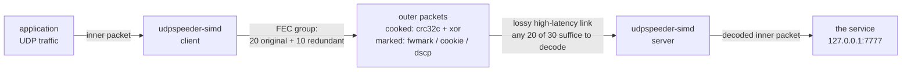
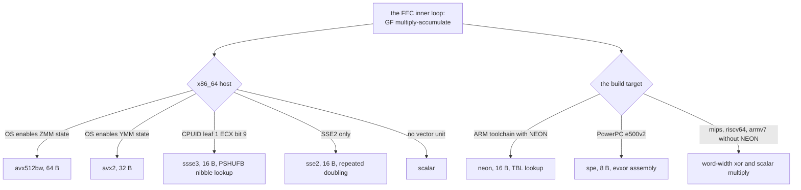
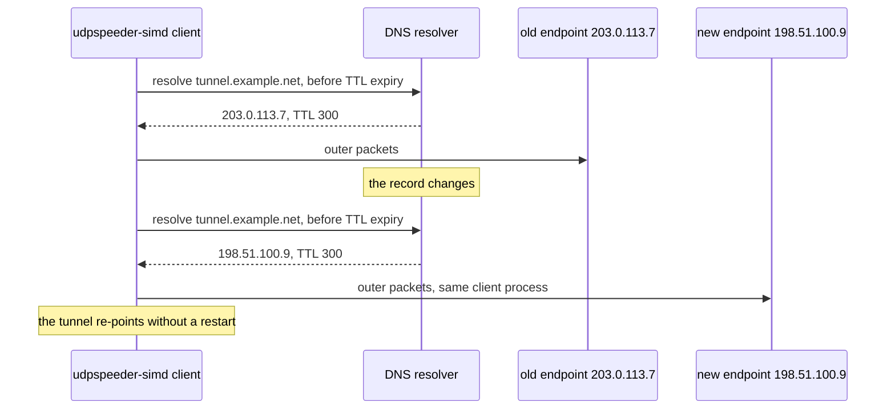

# udpspeeder-simd

A UDP tunnel that makes a high-latency, lossy link usable: it sends
Reed-Solomon redundancy across the path so the far end can rebuild what the
link dropped, and it does the math fast enough to matter (SIMD kernels, a
measured 657-1082 Mbps end to end with redundancy on CI hosts, not a
router capacity promise).

It is a fork of wangyu-'s [UDPspeeder](https://github.com/wangyu-/UDPspeeder),
and the foundation is his: the FEC design, the tunnel, the instincts. This
README covers what the fork became on top of that work, with every claim
below tied to a test, a measurement, or a document that says where it came
from.

[简体中文](doc/README.zh-cn.md) (section-for-section with this page)



Used alone it carries one UDP service. A UDP VPN over it carries the VPN's
protocols too, and whether that improves them depends on the loss shape and
spare bandwidth; the stacking's MTU behaviour is measured:
[the VPN guide](doc/vpn-over-the-tunnel.md) carries an MTU ledger read off
real captured packets.

## Why it is fast

The hot path is built from kernel families, each vectorized and each
dispatched to what the CPU actually has:

| family | what it does | tiers |
|---|---|---|
| addmul1 | the GF multiply-accumulate inside Reed-Solomon | avx512bw, avx2, ssse3, sse2, scalar, neon |
| xor_tile | the XOR of key and IV patterns over each packet | avx2, sse2, neon, spe, word |
| crc32c | the Castagnoli checksum | hardware (SSE4.2 / ARMv8), software |



The numbers, each from [OPTIMIZATION.md](OPTIMIZATION.md) or the bench lane:

| path | before | after |
|---|---|---|
| the multiply, per 1500 B | 665 ns | 58 ns (11.5x) |
| Reed-Solomon encode, k=10 n=15 | 34,000 ns | 3,100 ns (11x) |
| end to end with fec 20:10 | 364-509 Mbps | 657-1082 Mbps (+81-113%) |

Ranges are CI host variance; each before-and-after pair is measured on one
host in one run.

`bench/arch-map.tsv` records the Linux build targets and the dispatch each
binary must choose. CI runs the non-x86 targets under QEMU and holds x86
against named CPU models, so the dispatch is probed at run time.

## Why this fork

The differences from upstream, each with its evidence:

- The endpoint follows DNS: `-r` takes a hostname; a lease manager
  refreshes the record before its TTL expires and re-points the tunnel when
  the address changes, without a restart. The verification flips a live DNS
  answer and kills the old server: the same client process re-points and
  keeps passing traffic (`bench/recipes-check.sh`).
- Socket marks: `--fwmark`, `--cookie` and `--dscp` name the tunnel's
  own packets to your network, with a contract: a mark the host cannot honor
  is refused at startup, never silently dropped. CI proves the priority byte
  leaves the host by capturing packets on Linux, FreeBSD and Windows
  ([the marks guide](doc/socket-marks.md)).
- The suite runs on Linux, FreeBSD, Windows and macOS in CI, and the wire
  proofs capture real packets on each.
- Release assets cover seven Linux architectures (built with the
  OpenWrt toolchains), both Windows worlds, and one universal macOS binary.
- The renamed binary: one name everywhere, `udpspeeder-simd`.

## Quick start

A server with a UDP service on port 7777, a client that wants it at
localhost:3333, redundancy of 10 packets per 20:

```bash
# server side
udpspeeder-simd -s -l0.0.0.0:4096 -r127.0.0.1:7777 -f20:10 -k "passwd"

# client side
udpspeeder-simd -c -l127.0.0.1:3333 -r<server-address>:4096 -f20:10 -k "passwd"
```

With both sides running, UDP traffic sent to 127.0.0.1:3333 arrives at the
server's port 7777, with any 20 of every 30 packets on the wire enough to
rebuild the group. `-f20:10` is the ratio (20 originals, 10 redundant); `-k`
adds XOR obfuscation, which is not encryption (below).

Get the binary from the
[releases](https://github.com/connollydavid/UDPspeeder-simd/releases): one
asset per target, listed in the which-binary table below.

## Running on OpenWrt

The release binaries are built with the OpenWrt target toolchains and run on
a stock router: static, about 4.2 MB, no kernel modules, with a receive path
that falls back where the kernel lacks io_uring. The guide turns one into an
appliance: a procd service that starts at boot, restarts on exit under its
respawn policy, and reads
`/etc/config/udpspeeder-simd`, so the UCI stanzas in this README work
verbatim on a binary deployment; `uci commit udpspeeder-simd` saves and
`/etc/init.d/udpspeeder-simd reload` applies (the reload trigger also fires
on commit); `logread` shows the report counters, and one line in `/etc/sysupgrade.conf` carries the
binary across firmware upgrades. The full guide, with the init script ready
to paste: [doc/openwrt.md](doc/openwrt.md).

## Stack a VPN over it

The tunnel carries UDP; a UDP VPN rides it as payload and brings every
protocol with it. The inner link runs at the idiomatic Ethernet 1500 (the
encoder re-segments beneath it, so the customary VPN MTU arithmetic buys
nothing), and the outer packets never exceed 1313 bytes measured, below even
PPPoE's 1492:

| stack | inner MTU | outer ceiling |
|---|---|---|
| WireGuard over the tunnel | 1500 (interface) | 1304 measured |
| OpenVPN UDP over the tunnel | 1500 (interface) | 1254 measured |


OpenVPN's TCP transport cannot ride the tunnel (its SYN meets a UDP
listener; the ledger records the refusal), and TCP traffic crosses the
tunnel as flows inside a UDP VPN. The
[VPN guide](doc/vpn-over-the-tunnel.md) discusses the tradeoff this leaves
open: on loss, the tunnel's redundancy and TCP's own retransmission both
spend, and whether that double spend pays depends on whether your loss is
burst-shaped or congestion-shaped.

## Tuning a lossy link

Start from measurement: run with `--report 10` and read its cumulative
original and FEC packet and byte counts (it prints counters, not a loss
rate), then choose the ratio. The arithmetic of what a ratio buys:

| ratio | bandwidth | survives per-group loss | shape |
|---|---|---|---|
| `-f4:2` | 1.5x | up to 1/3 | four-original groups |
| `-f20:10` | 1.5x | up to 1/3 | twenty-original groups; the default |
| `-f1:1` | 2x | up to 1/2 | one redundant packet per original |
| `-f1:3` | 4x | up to 3/4 | three redundant packets per original |

The fifo accepts `fec`, `timeout`, `queue-len`, `mtu` and `mode` from a
running instance (the first three verified by `bench/recipes-check.sh`);
startup options such as `remote` and `key` are not live-tunable. With
`option fifo '/tmp/fifo'` configured, `echo "fec 4:2" > /tmp/fifo` changes
the running encoder until restart; persist the ratio in UCI before reloading. The full method, including how to read the
report against the double spend, is in the ratio table above and the
[VPN guide](doc/vpn-over-the-tunnel.md)'s loss discussion.

On OpenWrt, the same tuning as UCI:

```
config udpspeeder-simd 'tunnel1'
	option enabled '1'
	option server '0'
	option local '127.0.0.1:3333'
	option remote '<server>:4096'
	option fec '4:2'
	option report '10'
	option fifo '/tmp/fifo'
	option key 'passwd'
```

The key here is XOR obfuscation, not encryption, authentication, or access
control; use a real VPN for payload security.

## The moving endpoint

Give the client a hostname and it follows the address: the lease manager
resolves `-r` names, refreshes before TTL expiry, and re-points when the
answer changes, without a restart. An address change no longer reads as an
outage.

```bash
udpspeeder-simd -c -l127.0.0.1:3333 -rmytunnel.example.net:4096 \
  -f20:10 -k "passwd"
```

The key is XOR obfuscation, not encryption or access control.

On OpenWrt the `remote` option takes the hostname the same way.




## Scope and limits

The tunnel carries UDP datagrams; TCP traffic and whole-network access
require a UDP VPN stacked over it. FEC repairs loss but cannot create
bandwidth, and congestion loss is better left to TCP's own backoff. `-k` is
XOR obfuscation with random padding, not encryption at all; confidentiality
and integrity are the stacked VPN's job. It forwards one UDP service, and
on a clean link it only adds redundancy and CPU cost.

## Which binary

The release ships one asset per target; the build matrix behind them is
`bench/arch-map.tsv`, the same table CI holds as a check:

| asset | machine |
|---|---|
| `udpspeeder-simd.x86_64` | x86_64 Linux, back to the first K8 (Linux 3.2+) |
| `udpspeeder-simd.aarch64` | 64-bit ARM |
| `udpspeeder-simd.armv7-neon` | 32-bit ARM with NEON |
| `udpspeeder-simd.armv7-scalar` | 32-bit ARM without NEON |
| `udpspeeder-simd.mips` | big-endian MIPS |
| `udpspeeder-simd.powerpc` | PowerPC e500v2 |
| `udpspeeder-simd.riscv64` | 64-bit RISC-V |
| `udpspeeder-simd.x86_64.exe` | Windows x86_64 |
| `udpspeeder-simd.aarch64.exe` | Windows on ARM |
| `udpspeeder-simd` | macOS, Intel and Apple silicon, one universal binary |

```bash
curl -LO https://github.com/connollydavid/UDPspeeder-simd/releases/latest/download/udpspeeder-simd.x86_64
chmod +x udpspeeder-simd.x86_64 && ./udpspeeder-simd.x86_64 -h
```

On OpenWrt, [the guide](doc/openwrt.md) walks the same release assets onto a
router as a managed service.

## Platforms and privileges

| platform | status | source |
|---|---|---|
| Linux (seven architectures) | built, tested, shipped as assets | release + CI matrix |
| Windows x86_64 | built, tested under wine and natively, shipped | release + CI matrix |
| Windows ARM64 | built natively, banner-smoke tested, shipped | release + CI matrix |
| macOS (Intel and Apple silicon) | built and tested in CI, shipped as one universal binary | release + CI matrix |
| FreeBSD | built and tested in CI | no release asset |

| option | privilege |
|---|---|
| none | the binary needs no special privileges when run by hand; the procd script runs it as root |
| `--fwmark` | root or CAP_NET_ADMIN (Linux) |
| `--cookie`, `--dscp` | none beyond a normal user |

## Troubleshooting

The common failures, in symptom-cause-fix form with each claim's source:
[doc/troubleshooting.md](doc/troubleshooting.md).

## Verification

The DNS lease and socket-mark behaviour is specified in `dns_lease_mgr.allium`
and `socket_marks.allium`; CI runs their checks and validates the obligations
manifests. Timing properties are modelled in TLA+ and checked across every
interleaving the finite model can express. The dispatch table is held against
named CPU models in CI. The MTU numbers were measured from packets captured
on a loopback stacked link by `bench/vpn-ledger.sh`, and the marks byte is
proven on the wire by packet capture on Linux, Windows and macOS, with the
FreeBSD and macOS lanes best-effort (`continue-on-error`) and the macOS
release asset taken only when its lane supplies it. Where a claim holds only
on some platforms, the tables above say which. Two languages can drift apart
without anyone noticing, so a [terminology table](doc/terminology.md) records
the intended vocabulary in both; synchronization is reviewed by hand.

## License and credit

The software is MIT (see [LICENSE.md](LICENSE.md)). It builds on
wangyu-'s [UDPspeeder](https://github.com/wangyu-/UDPspeeder): the
Reed-Solomon tunnel and the FEC design are his, and this fork carries them
forward with its own kernels, marks, endpoint and measurements. The upstream
wiki remains worth reading for its tuning documentation.
