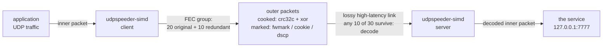
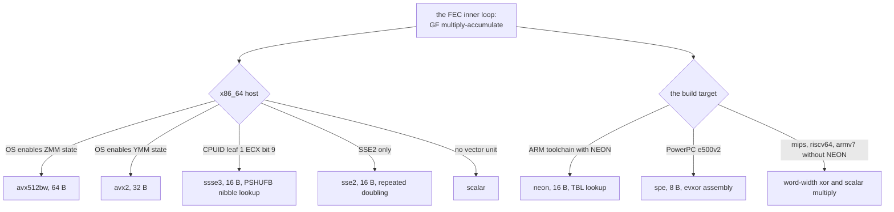
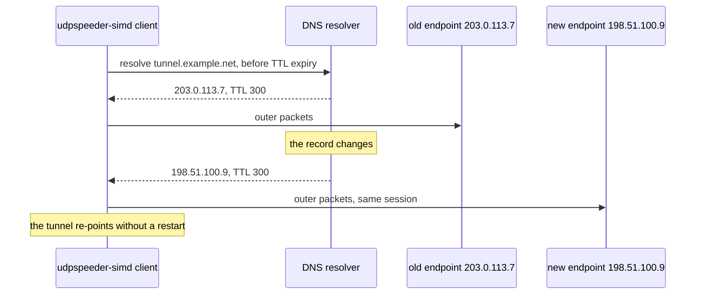

# udpspeeder-simd

A UDP tunnel that makes a high-latency, lossy link usable: it sends
Reed-Solomon redundancy across the path so the far end can rebuild what the
link dropped, and it does the math fast enough to matter (SIMD kernels, a
measured 657-1082 Mbps end to end with redundancy on).

It is a fork of wangyu-'s [UDPspeeder](https://github.com/wangyu-/UDPspeeder),
and the foundation is his: the FEC design, the tunnel, the instincts. What
you are reading about here is what this fork became on top of that
foundation, with every claim below tied to a test, a measurement, or a
document that says where it came from.

[简体中文](doc/README.zh-cn.md) (section-for-section with this page)



Used alone it improves UDP flows. Stacked under a UDP VPN (WireGuard,
OpenVPN) it improves everything, and the stacking is measured: the
[VPN guide](doc/vpn-over-the-tunnel.md) carries an MTU ledger read off real
captured packets.

## Why it is fast

The hot path is three kernel families, each vectorized and each dispatched
to what the CPU actually has:

| family | what it does | tiers |
|---|---|---|
| addmul1 | the GF multiply-accumulate inside Reed-Solomon | avx512bw, avx2, ssse3, sse2, scalar, neon |
| xor_tile | the XOR of key and IV patterns over each packet | avx2, sse2, neon, spe, word |
| crc32c | the Castagnoli checksum | hardware (SSE4.2 / ARMv8), software |



The numbers, each from [OPTIMIZATION.md](OPTIMIZATION.md) or the bench lane:

| path | before | after |
|---|---|---|
| the multiply, per 1500 B | 665 ns | 58 ns (11.5x) |
| Reed-Solomon encode, k=10 n=15 | 34,000 ns | 3,100 ns (11x) |
| end to end with fec 20:10 | 364-509 Mbps | 657-1082 Mbps (+81-113%) |

Ranges are CI host variance; each before-and-after pair is measured on one
host in one run.

Every tier in the diagram is a row in `bench/arch-map.tsv`, the same table
CI holds as a check under named QEMU CPU models: the dispatch is probed, not
assumed, on every architecture the release ships.

## Why this fork

The differences from upstream, each with its evidence:

- **The endpoint follows DNS.** `-r` takes a hostname; a lease manager
  refreshes the record before its TTL expires and re-points the tunnel when
  the address changes, without a restart. The verification flips a live DNS
  answer and kills the old server: the same client process re-points and
  keeps passing traffic (`bench/recipes-check.sh`).
- **Socket marks.** `--fwmark`, `--cookie` and `--dscp` name the tunnel's
  own packets to your network, with a contract: a mark the host cannot honor
  is refused at startup, never silently dropped. CI proves the priority byte
  leaves the host by capturing packets on Linux, FreeBSD and Windows
  ([the marks guide](doc/socket-marks.md)).
- **Four hosts, measured.** The suite runs on Linux, FreeBSD, Windows and
  macOS in CI, and the wire proofs capture real packets on each.
- **Ten release assets** covering seven Linux architectures (built with the
  OpenWrt toolchains), both Windows worlds, and one universal macOS binary.
- **The renamed binary.** One name everywhere: `udpspeeder-simd`.

Two scars from under the hood, because they taught the design:

The first is the SIGILL. The SSSE3 multiply was correct on every machine
anyone had, and a CPU without SSSE3 (AMD K8, early 64-bit Intel) died on the
first FEC batch: the dispatcher assumed what its developers' machines had.
The fix was not a patch for that CPU, it was a change in posture: probe
before you use, keep a slower tier beneath every faster one, and hold every
dispatch against a named CPU model in CI, forever, so a future kernel or
toolchain cannot quietly reintroduce the assumption.

The second is the pretending socket. On Windows, the DSCP socket option
reports success and marks nothing. The easy behavior would be to call it a
success and let your routing rules match empty air. The fork refuses
instead, at startup, with the reason; the same refusal discipline covers
`--fwmark` on the wrong platform. A mark is a promise, and promises that
cannot be kept are declined out loud.

## Quick start

A server with a UDP service on port 7777, a client that wants it at
localhost:3333, redundancy of 10 packets per 20:

```bash
# server side
udpspeeder-simd -s -l0.0.0.0:4096 -r127.0.0.1:7777 -f20:10 -k "passwd"

# client side
udpspeeder-simd -c -l127.0.0.1:3333 -r<server-address>:4096 -f20:10 -k "passwd"
```

Now UDP traffic sent to 127.0.0.1:3333 arrives at the server's port 7777,
with any 10 of every 30 packets on the wire enough to rebuild the group.
`-f20:10` is the ratio (20 originals, 10 redundant); `-k` adds XOR
obfuscation, which is not encryption (below).

Get the binary from the
[releases](https://github.com/connollydavid/UDPspeeder-simd/releases): ten
assets, one per target, listed in the which-binary table below.

## Running on OpenWrt

The release binaries are built with the OpenWrt target toolchains and run on
a stock router: static, about 4.2 MB, no kernel modules, with a receive path
that falls back where the kernel lacks io_uring. The guide turns one into an
appliance: a procd service that starts at boot, restarts on exit, and reads
`/etc/config/udpspeeder-simd`, so the UCI stanzas in this README work
verbatim on a binary deployment; `uci commit` applies changes, `logread`
shows the loss report, and one line in `/etc/sysupgrade.conf` carries the
binary across firmware upgrades. The whole story, with the init script ready
to paste: [doc/openwrt.md](doc/openwrt.md).

## Stack a VPN over it

The tunnel carries UDP; a UDP VPN rides it as payload and brings every
protocol with it. The measured story is short: the inner link runs at the
idiomatic Ethernet 1500 (the encoder re-segments beneath it, so the
customary VPN MTU arithmetic buys nothing), and the outer packets never
exceed 1313 bytes measured, below even PPPoE's 1492:

| stack | inner MTU | outer ceiling |
|---|---|---|
| WireGuard over the tunnel | 1500 (interface) | 1304 measured |
| OpenVPN UDP over the tunnel | 1500 (interface) | 1254 measured |



OpenVPN's TCP transport cannot ride the tunnel (its SYN meets a UDP
listener; the ledger records the refusal), and TCP traffic arrives the
working way: as flows inside a UDP VPN. That is where the one live tension
of stacking sits, named rather than resolved in the
[VPN guide](doc/vpn-over-the-tunnel.md): on loss, the tunnel's redundancy
and TCP's own retransmission both spend, and whether that double spend pays
depends on whether your loss is burst-shaped or congestion-shaped.

## Tuning a lossy link

Start from measurement: run with `--report 10`, read the loss it reports,
then choose the ratio. The arithmetic of what a ratio buys:

| ratio | bandwidth | survives per-group loss | shape |
|---|---|---|---|
| `-f4:2` | 1.5x | up to 1/3 | small groups, quick flush |
| `-f20:10` | 1.5x | up to 1/3 | the default, smoother under load |
| `-f1:1` | 2x | up to 1/2 | per-packet doubling, best for games |
| `-f1:3` | 4x | up to 3/4 | rescue mode for very bad links |

Everything is live-tunable through the fifo: `echo "fec 4:2" > /tmp/fifo`
retunes a running instance (verified by the recipes check, along with the
timeout and queue-len levers). The full method, including how to read the
report against the double-spend tension, is the tuning material above and
the [VPN guide](doc/vpn-over-the-tunnel.md)'s loss discussion.

The OpenWrt door, the same tuning as UCI:

```
config udpspeeder-simd 'tunnel1'
	option enabled '1'
	option server '0'
	option local '127.0.0.1:3333'
	option remote '<server>:4096'
	option fec '4:2'
	option report '10'
	option fifo '/tmp/udpspeeder-fifo'
	option key 'passwd'
```

## The moving endpoint

Give the client a hostname and it follows the address: the lease manager
resolves `-r` names, refreshes before TTL expiry, and re-points when the
answer changes, without a restart. A moving endpoint stops reading as an
outage.

```bash
udpspeeder-simd -c -l127.0.0.1:3333 -rmytunnel.example.net:4096 \
  -f20:10 -k "passwd"
```

On OpenWrt the `remote` option takes the hostname the same way.

## What this is not

Five honest lines, so nobody arrives by mistake:

1. Not a TCP tunnel: it carries UDP datagrams; TCP traffic rides a VPN
   stacked on top.
2. Not magic against congestion: FEC repairs loss; it cannot create
   bandwidth, and congestion loss is better left to TCP's own backoff.
3. Not strong encryption: `-k` is XOR obfuscation with random padding;
   confidentiality is the stacked VPN's job.
4. Not a VPN by itself: it forwards one UDP service; the VPN guide is where
   whole-network access comes from.
5. Not a WAN optimizer: on a clean link it only adds redundancy.

## Which binary

The release ships one asset per target; the build matrix behind them is
`bench/arch-map.tsv`, the same table CI holds as a check:

| asset | machine |
|---|---|
| `udpspeeder-simd.x86_64` | any x86_64 Linux, back to the first K8 |
| `udpspeeder-simd.aarch64` | 64-bit ARM |
| `udpspeeder-simd.armv7-neon` | 32-bit ARM with NEON |
| `udpspeeder-simd.armv7-scalar` | 32-bit ARM without NEON |
| `udpspeeder-simd.mips` | big-endian MIPS |
| `udpspeeder-simd.powerpc` | PowerPC e500v2 |
| `udpspeeder-simd.riscv64` | 64-bit RISC-V |
| `udpspeeder-simd.x86_64.exe` | Windows x86_64 |
| `udpspeeder-simd.aarch64.exe` | Windows on ARM |
| `udpspeeder-simd` | macOS, Intel and Apple silicon, one universal binary |

```bash
curl -LO https://github.com/connollydavid/UDPspeeder-simd/releases/download/v1.2.2/udpspeeder-simd.x86_64
chmod +x udpspeeder-simd.x86_64 && ./udpspeeder-simd.x86_64 -h
```

On OpenWrt, [the guide](doc/openwrt.md) walks the same release assets onto a
router as a managed service.

## Platforms and privileges

| platform | status | source |
|---|---|---|
| Linux (seven architectures) | built, tested, shipped as assets | release + CI matrix |
| Windows x86_64 and ARM64 | built, tested under wine and natively, shipped | release + CI matrix |
| macOS (Intel and Apple silicon) | built and tested in CI, shipped as one universal binary | release + CI matrix |
| FreeBSD | built and tested in CI | build from source |

| option | privilege |
|---|---|
| none | the tunnel runs unprivileged |
| `--fwmark` | root or CAP_NET_ADMIN (Linux) |
| `--cookie`, `--dscp` | none beyond a normal user |

## Troubleshooting

Four symptoms cover most of what goes wrong, each in symptom-cause-fix
form, each naming where its claim comes from: the refused startup naming a
mark, the size threshold where packets vanish, the DSCP value that leaves
your host and stops being honored past a hop you do not control, and the
ratio increase that makes loss worse. The guide:
[doc/troubleshooting.md](doc/troubleshooting.md).

## The evidence posture

What this fork claims, it tests. The specifics live where they belong: the
behaviour spec and its obligations in `socket_marks.allium` and
`dns_lease_mgr.allium` (run by CI), the timing models in `spec/` under TLA+,
the SIMD dispatch held against named CPU models, the MTU ledger read off
captured packets, and the marks byte proven on the wire on every host the
CI runs. Where something is only true on some platforms, the tables above
say so.

## License and credit

The software is MIT (see [LICENSE.md](LICENSE.md)). It stands on
wangyu-'s [UDPspeeder](https://github.com/wangyu-/UDPspeeder): the
Reed-Solomon tunnel, the FEC design and the tuning instincts are his, and
this fork carries them forward with its own kernels, marks, endpoint and
measurements. The upstream wiki remains worth reading for the tuning lore
this fork's measurements now back with numbers.
