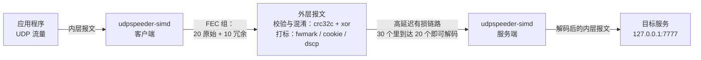
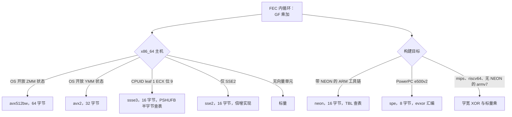
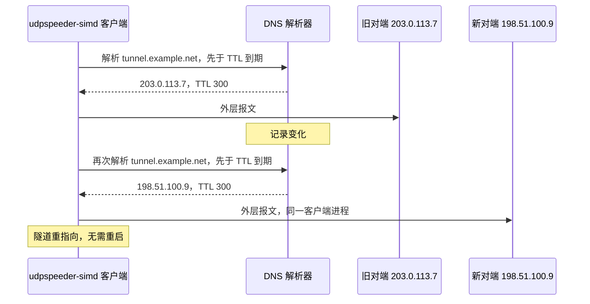

# udpspeeder-simd

一条让高延迟、高丢包链路可用的 UDP 隧道：向链路发送 Reed-Solomon 冗余，让对端重建链路丢掉的内容；并且算得足够快（SIMD 计算内核；CI 主机启用冗余后的端到端实测吞吐为 657-1082 Mbps，不代表各款路由器的表现）。

它是 wangyu-'s [UDPspeeder](https://github.com/wangyu-/UDPspeeder) 的分支，基础来自上游：FEC 设计、隧道与调优的直觉。本页描述这个分支在上述基础上的现状，下方每个主张都落在测试、测量或写明出处的文档上。

[English](../../README.md)（与本页逐节对应）



单独使用时它改善 UDP 流量。叠加在 UDP VPN（WireGuard、OpenVPN）之下时，所有协议都受益，且这一点经过实测：[VPN 指南](vpn-over-the-tunnel.md)携带一张从真实抓包读出的 MTU 实测记录。

## 为什么快

热路径按计算内核类别组织。每族各自向量化，并按 CPU 实际具备的能力分发：

| 族 | 职责 | 层级 |
|---|---|---|
| addmul1 | Reed-Solomon 内部的 GF 乘加 | avx512bw、avx2、ssse3、sse2、标量、neon |
| xor_tile | 每个报文上密钥与 IV 图案的 XOR | avx2、sse2、neon、spe、字宽 |
| crc32c | Castagnoli 校验和 | 硬件（SSE4.2 / ARMv8）、软件 |



数字如下，每一项来自 [OPTIMIZATION.md](../OPTIMIZATION.md) 或基准测试：

| 路径 | 之前 | 之后 |
|---|---|---|
| 乘加，每 1500 字节 | 665 ns | 58 ns（11.5 倍） |
| Reed-Solomon 编码，k=10 n=15 | 34,000 ns | 3,100 ns（11 倍） |
| 端到端，fec 20:10 | 364-509 Mbps | 657-1082 Mbps（+81-113%） |

区间反映 CI 主机之间的性能差异。每对前后数据在同一台主机、同一次运行内测得。

图中每个层级都是 `bench/arch-map.tsv` 中的一行，CI 在指定的 QEMU CPU 模型下把它当作检查来执行。分发靠运行时探测得出，覆盖发布的每个架构。

## 为何选择这个分支

与上游的差异，各带证据：

- 对端跟随 DNS：`-r` 接受主机名；租约管理器在 TTL 到期前刷新记录，地址变化时把隧道指向新地址，无需重启。验证方式是动态修改 DNS 应答并停止旧服务端：同一个客户端进程切换到新地址并继续通过流量（`bench/recipes-check.sh`）。
- 套接字标记：`--fwmark`、`--cookie` 与 `--dscp` 为隧道自身的报文打上标记，供所在网络的规则识别。契约是要么打上、要么拒绝：主机打不上的标记在启动时拒绝，不静默丢弃。CI 在 Linux、FreeBSD、Windows 上抓取真实报文，证明优先级字节确实离开了主机（[标记指南](socket-marks.md)）。
- 测试套件在 CI 中运行于 Linux、FreeBSD、Windows 与 macOS。各平台均通过实际抓包验证标记字节。
- 十件发布文件，覆盖七个 Linux 架构（以 OpenWrt 工具链构建）、两个 Windows 目标，以及一件 macOS 通用二进制。
- 二进制统一命名，所有平台都叫 `udpspeeder-simd`。

## 快速上手

服务端在 7777 端口有一个 UDP 服务。客户端想在本地 3333 端口使用它，冗余为每 20 个包 10 个：

```bash
# 服务端
udpspeeder-simd -s -l0.0.0.0:4096 -r127.0.0.1:7777 -f20:10 -k "passwd"

# 客户端
udpspeeder-simd -c -l127.0.0.1:3333 -r<server-address>:4096 -f20:10 -k "passwd"
```

此后发往 127.0.0.1:3333 的 UDP 流量到达服务端的 7777 端口，线路上每 30 个外层报文中任意 20 个到达即可重建整组。`-f20:10` 是冗余比（20 原始，10 冗余）。请在服务端防火墙放行 UDP 4096（条件允许时限定为客户端地址），后端服务保持在 127.0.0.1:7777，不要单独暴露到公网。；`-k` 加上 XOR 混淆，它不是加密（见下文）。

二进制从 [发布页](https://github.com/connollydavid/UDPspeeder-simd/releases) 获取，每个目标一个发布文件。清单见下文的二进制对照表。

## 在 OpenWrt 上运行

发布二进制由 OpenWrt 目标工具链构建，在标准 OpenWrt 系统上直接可用：静态链接，依目标约 1.3-4.1 MB，无需内核模块；内核缺少 io_uring 时收包路径自动回退。指南把二进制变成设备级服务：procd 守护开机自启，进程退出后按 respawn 策略重启，并读取 /etc/config/udpspeeder-simd，因此本页所有 UCI 配置段在纯二进制部署上原样可用；uci commit udpspeeder-simd 保存配置，/etc/init.d/udpspeeder-simd reload 应用配置（reload trigger 也会在提交后触发），logread 查看运行日志和周期输出的累计报文、字节计数，/etc/sysupgrade.conf 加一行即可让二进制随固件升级保留。完整过程与可直接粘贴的 init 脚本见 [openwrt.md](openwrt.md)。

## 在其上叠加 VPN

隧道搬运 UDP；UDP VPN 把全部流量当作 UDP 载荷交给隧道，所有协议随之通过。实测结论：内层链路跑在常见的以太网 1500 上（编码器在下面重新分段，常规的 VPN MTU 计算在这里不会带来收益），本次实测外层报文最大为 1304 字节，低于 PPPoE 的 1492：

| 叠加 | 内层 MTU | 外层上限 |
|---|---|---|
| WireGuard 叠加隧道 | 1500（接口） | 实测 1304 |
| OpenVPN UDP 叠加隧道 | 1500（接口） | 实测 1254 |


OpenVPN 的 TCP 传输无法通过隧道（它的 SYN 发到的是一个 UDP 监听端口；账目记录了这次拒绝），TCP 应用流量可以作为 UDP VPN 内部的流通过隧道：作为 UDP VPN 内部的流。叠加中的由此产生的带宽开销与 TCP 重传的关系，[VPN 指南](vpn-over-the-tunnel.md) 展开讨论：丢包时，隧道的冗余与 TCP 自身的重传各自花一份带宽，是否合算取决于丢包是突发的还是拥塞的。

## 调优一条高丢包链路

从测量出发：带 `--report 10` 运行，读它周期输出的双向原始报文与 FEC 报文的累计数量及字节数（它输出计数，不直接给出丢包率），再选冗余比。各比值换来的带宽与组内可承受丢包如下：

| 比值 | 带宽 | 组内可承受丢包 | 形态 |
|---|---|---|---|
| `-f4:2` | 1.5 倍 | 至多 1/3 | 四个一组 |
| `-f20:10` | 1.5 倍 | 至多 1/3 | 二十个一组，默认值 |
| `-f1:1` | 2 倍 | 至多 1/2 | 每个原始报文一份冗余 |
| `-f1:3` | 4 倍 | 至多 3/4 | 每个原始报文三份冗余，需先确认上行余量 |

fec、timeout、queue-len、mtu 和 mode 可通过实例配置的 fifo 在线调整（前三项由 `bench/recipes-check.sh` 检查）；remote 和 key 等启动选项不能在线调整。使用下文 UCI 配置时，执行 `echo "fec 4:2" > /tmp/fifo`，改动持续到重启为止，重载或升级前请把比值写回 UCI：`echo "fec 4:2" > /tmp/fifo` 让运行中的实例调整参数（timeout 与 queue-len 同样支持，均由 recipes 校验脚本验证）。带宽开销以及 TCP 重传与 FEC 冗余的关系，见上面的对照表与 [VPN 指南](vpn-over-the-tunnel.md) 的丢包讨论。

OpenWrt 上，同样的调优写成 UCI：

```
config udpspeeder-simd 'tunnel1'
	option enabled '1'
	option server '0'
	option local '127.0.0.1:3333'
	option remote '<server>:4096'
	option fec '4:2'
	option report '10'
	option fifo '/tmp/fifo'
	option key 'passwd'
```

## 对端地址变化

给客户端一个主机名，它就跟随地址变化：租约管理器解析 `-r` 里的名字，在 TTL 到期前刷新，应答变化时把隧道指向新地址，无需重启。移动的对端不再表现为断线。

```bash
udpspeeder-simd -c -l127.0.0.1:3333 -rmytunnel.example.net:4096 \
  -f20:10 -k "passwd"
```

OpenWrt 上 remote 选项同样接受主机名。




## 适用范围与限制

隧道搬运 UDP 数据报；TCP 流量和整网接入需要叠加 UDP VPN。FEC 修复丢包，不能凭空造带宽；拥塞丢包交给 TCP 自己的退避更合适。`-k` 只是带随机填充的 XOR 混淆，不是加密，也不提供身份认证；需要保密性时应叠加 WireGuard 等真正加密的 VPN。它只转发一个 UDP 服务；无丢包链路上它只增加冗余和计算开销。

## 哪台机器用哪个二进制

发布为每个目标备一个发布文件。背后的构建矩阵是 `bench/arch-map.tsv`，与 CI 检查用的是同一张表：

| 资产 | 机器 |
|---|---|
| `udpspeeder-simd.x86_64` | x86_64 Linux，最低为第一代 K8（Linux 3.2 及以上） |
| `udpspeeder-simd.aarch64` | 64 位 ARM |
| `udpspeeder-simd.armv7-neon` | 带 NEON 的 32 位 ARM |
| `udpspeeder-simd.armv7-scalar` | 无 NEON 的 32 位 ARM |
| `udpspeeder-simd.mips` | 大端 MIPS |
| `udpspeeder-simd.powerpc` | PowerPC e500v2 |
| `udpspeeder-simd.riscv64` | 64 位 RISC-V |
| `udpspeeder-simd.x86_64.exe` | Windows x86_64 |
| `udpspeeder-simd.aarch64.exe` | Windows on ARM |
| `udpspeeder-simd` | macOS，Intel 与 Apple 芯片，单个通用二进制 |

```bash
curl -LO https://github.com/connollydavid/UDPspeeder-simd/releases/latest/download/udpspeeder-simd.x86_64
chmod +x udpspeeder-simd.x86_64 && ./udpspeeder-simd.x86_64 -h
```

在 OpenWrt 上，[指南](openwrt.md) 沿着同一批发布文件把二进制部署为受管服务。

## 平台与权限

| 平台 | 状态 | 来源 |
|---|---|---|
| Linux（七个架构） | 构建、测试并构建、测试并发布 | 发布页 + CI 矩阵 |
| Windows x86_64 | 构建，在 wine 与原生环境测试并发布 | 发布页 + CI 矩阵 |
| Windows ARM64 | 原生构建、启动冒烟测试并发布 | 发布页 + CI 矩阵 |
| macOS（Intel 与 Apple 芯片） | CI 构建测试，单个通用二进制发布 | 发布页 + CI 矩阵 |
| FreeBSD | CI 构建测试 | 无发布文件 |

| 选项 | 权限 |
|---|---|
| 无 | 手动运行时无需特殊权限；所附 OpenWrt procd 脚本默认以 root 运行 |
| `--fwmark` | root 或 CAP_NET_ADMIN（Linux） |
| `--cookie`、`--dscp` | 普通用户即可 |

## 故障排查

指南里的排查按症状-原因-处置组织，各条写明主张出处，列出常见故障：因标记不受支持而拒绝启动、报文超过某一大小后丢失、DSCP 值离开主机后你控制不到的中间跳不再尊重它、提高冗余比反而丢得更多。详见 [troubleshooting.md](troubleshooting.md)。

## 验证

DNS 租约与套接字标记的行为写成分规格文件 `dns_lease_mgr.allium` 与 `socket_marks.allium`，CI 运行其检查并校验 obligations 清单。时序性质以 TLA+ 建模，在有限模型能表达的全部交错上检查。分派表在 CI 中对照具名 CPU 模型执行。MTU 数字来自 `bench/vpn-ledger.sh` 在回环叠加链路上的抓包测量；标记字节由 Linux、Windows、macOS 的抓包作业验证，FreeBSD 与 macOS 作业为 continue-on-error 的尽力而为通道，macOS 发布文件在其作业提供时才附带。只在部分平台成立的结论，上文的表格写明是哪些。两种语言会在无人察觉时漂移，[术语表](terminology.md) 记录双语的预期用词，同步由人工审阅。

## 许可证与致谢

软件为 MIT（见 [LICENSE.md](../LICENSE.md)）。它基于 wangyu- 开发的 [UDPspeeder](https://github.com/wangyu-/UDPspeeder) 之上：Reed-Solomon 隧道、FEC 设计与调优直觉是他的，本分支并加入自己的计算内核、套接字标记、DNS 对端跟随和实测数据。上游 wiki 的调优经验至今值得读。
